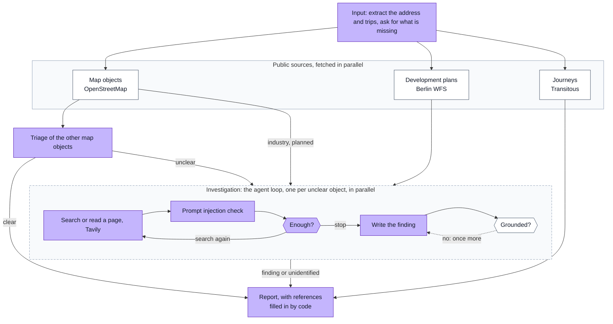

#  Out of Frame

*The questions nobody showing you the home is obliged to ask.*

[](https://github.com/avashchenkov/out-of-frame/actions/workflows/ci.yml)

[](LICENSE)

An AI agent that checks a Berlin address for what a property listing leaves out: nearby
industry, wastewater treatment plants, airports, major roads and railways, and planned
development. Every finding it reports cites its source.

A [demo](#the-demo) with five recorded examples and a private chat runs on one server; its
link is not public, so that its daily limits stay for invited reviewers.

## What it does

You give it an address or a listing. It asks where you travel regularly and when, then:

1. finds what is nearby on OpenStreetMap and in Berlin's development plans;
2. settles what each object is and whether it is in use, from its map data or by searching
   the web for it, and leaves an object unidentified when no page settles it;
3. plans your journeys there and back by public transport, for up to two destinations by default;
4. writes a report: what each object is, how far it is, why it matters to someone living
   there, and the source of each fact.

It writes in the language you write in.

## How it works



Purple: the model decides. White: code decides. The [architecture](docs/architecture.md)
has the full flow and the state; the graphs exactly as LangGraph compiles them are in
[compiled-graph.md](docs/compiled-graph.md), and a test fails when they drift from the code.

**Stack:** Python 3.14, LangGraph, Claude Haiku 5.5, Tavily; the demo on Aegra, PostgreSQL,
Redis, Next.js, Caddy and Docker Compose; GitHub Actions.

## Results

At five Berlin addresses, 68 nearby objects have a checked label: what it is and whether it
is in use. 32 of them are scored. The other 36 are left out, each with its reason: 14 have no
page within the agent's reach, and 22 are left out of the MVP
([labels left out](docs/evals/2026-10-21-mvp-eval-results.md#labels-left-out)). A model's
answers vary from run to run, so the agent ran three times at each address, on live data. An
object counts as right when the agent got it right in two runs of three at least.
Details: [MVP eval results](docs/evals/2026-10-21-mvp-eval-results.md).

| | Before the fixes | After the fixes |
|---|---|---|
| Objects right | 27 of 32 | 32 of 32 |
| Wrong claims, in 96 answers (32 objects, 3 runs) | 9 | 1 |
| False alarms: a finding that matches no label | 0 | 0 |

The one wrong claim left is about plan 2-56E. The plan only says "business area", which does
not show what may be built, so the right answer is "kind unknown". In one run of three, the
model read a news page about workshops on that land today as what the plan allows, and called
it production. The model applied the plan rule wrongly; the search was not the cause.

What the fixes changed:

- **Railways.** The agent took two railway lines for in use from their map tags. No page that
  the agent's search finds shows reliably whether trains run on a line, so code now leaves a
  railway's status unknown.
- **Development plans.** Five plans got a wrong kind or none. Written rules for each kind of
  planned area, such as housing, mixed use or a core area, fixed all five.

Other checks:

- **Held-out addresses.** The fixes were tuned on the five addresses above. Two more, E6 and
  E7, were added after the fixes and never used for tuning, like a test set. There all 23
  answers that the agent gave were right, with no false alarms. 4 more answers are missing,
  because the public map server failed in two runs of E7. A second run of E7, where every
  source answered, got 9 of 9 right. Two addresses are too few for an accuracy rate across
  Berlin.
- **Each statement against its source.** An LLM judge, first checked against human grades,
  compares each statement of a report with the source it cites: 188 of 199 were backed. Of the
  11 it flagged, 3 are its own known mistake: it takes railway land in a plan for a running
  railway. The other 8 say more than their source shows, such as a site in use, from a page
  that does not give its address.
- **Explanation and no advice.** Two more judges check that a report explains each object by
  its kind and gives no advice: all 15 reports pass.
- **Prompt injection.** Pages with planted instructions: the check caught every one, with no
  false alarms.
- **Cost.** About $0.23 and a few minutes per run: $0.17 for Tavily, $0.06 for Claude.

## Design choices

- **An agent only where it is needed.** The model directs its own steps only in the
  investigation of an unclear object; the rest is a workflow fixed in code
  ([ADR 2](docs/adr/0002-why-an-agent.md)).
- **LangGraph** for the state, the pauses for user input and the parallel investigations
  ([ADR 1](docs/adr/0001-langgraph.md)).
- **Live sources, no index of our own:** no vector store or crawled copy of the web; the facts
  come from the map, the plans, the journey planner and web search during the run
  ([ADR 3](docs/adr/0003-live-sources.md)).
- **Grounded findings:** code checks that the key facts of a finding appear word for word in
  the page, map or plan data it cites, and fills in the references itself.
- **A prompt injection check:** a separate model call checks each search result and page
  before the investigation reads it.
- **No MCP:** no clients outside the system need the tools; they call Tavily through a small
  facade with a stub for tests.
- **No baseline:** the choice of an agent for one step follows Anthropic's
  [Building effective agents](https://www.anthropic.com/engineering/building-effective-agents);
  it was not measured against a simpler design.
- **The demo on Aegra and Agent Chat UI,** self-hosted on one server
  ([ADR 4](docs/adr/0004-demo-aegra-and-agent-chat-ui.md)).

## Evaluation

- **Component suites** check each model decision on fixed data: triage, the prompt injection
  check, the stopping decision, the finding, the input loop and the report.
- **End-to-end suite:** the whole agent on live sources at five Berlin addresses, E1–E5, graded
  by code against labels. One model proposed the labels, others checked them without seeing
  each other's checks, and a person settled where they disagreed.
- **LLM judges** grade the reports: support, interpretation and no verdict. They were
  calibrated against human grades, and a judge runs only at the version that passed.

The [eval architecture](docs/eval-architecture.md) says what each suite measures and how it is
graded.

The offline checks need no keys: tests, the code graders and the task format. The demo tests
also need Aegra, from the `demo` extra:

```bash
uv sync --extra demo
uv run pytest
```

CI runs them with lint and formatting, the Web UI checks and the demo's integration checks in
Docker.

A suite runs each task k times:

```bash
uv run --env-file .env python -m evals.run --part draft_finding --k 3
```

The parts are `check_page`, `draft_finding`, `decide_enough`, `investigate`,
`triage_object`, `write_report`, `run_input_loop` and `run_end_to_end`. The end-to-end suite
runs live and costs about $4 at k=3, the judges included. Results are saved in
`evals/results/`, which git ignores.

`write_report` and `run_end_to_end` also run the LLM judges. Their calibration check needs the
saved runs the judges were calibrated on, which hold the web pages the agent read and so stay
local: on a fresh clone these two suites stop before any paid call.

## Run it

You need [uv](https://docs.astral.sh/uv/) and your own API keys for
[Anthropic](https://console.anthropic.com/settings/keys) and [Tavily](https://app.tavily.com).

```bash
git clone https://github.com/avashchenkov/out-of-frame.git
cd out-of-frame
uv sync
cp .env.example .env
```

Fill in `ANTHROPIC_API_KEY` and `TAVILY_API_KEY` in `.env`, then:

```bash
uv run --env-file .env out-of-frame "Freiheit 22, 13597 Berlin"
```

The agent asks its questions in the terminal and prints the report. A run takes a few minutes
and costs about $0.23 in API calls: $0.17 for Tavily, some 20 searches and page reads, and
$0.06 for Claude. The map, plans and journey planner are free public services. Only the two
keys are required; every other setting has a default in `src/out_of_frame/config.py`, and
`.env.example` shows the common ones.

### The web UI without keys

With Docker, run the real Web UI, Aegra, PostgreSQL and Redis with a stub agent in place of
the real one:

```bash
docker compose --file demo/compose.stub.yaml up --build --wait
```

Then open <http://localhost:3000>. See
[demo/README.md](demo/README.md#local-ui-stack-with-a-stub-agent).

## The demo

The demo has two parts:

- **Five recorded examples,** each with the date of its research, open to everyone; they are
  kept in [recorded-examples.json](demo/frontend/src/data/recorded-examples.json).
- **A private live chat** without sign-up. A signed cookie gives one browser its own chat.
  Daily and per-browser limits keep the cost bounded. A chat is deleted 30 days after its
  first message, or earlier by the visitor. Visitor reports are never published.

The browser never talks to the agent directly: a Next.js proxy builds each allowed request
and filters every response through allowlists, so no internal state or page text reaches the
browser. One run executes at a time; Delete chat removes the thread, its runs and
checkpoints. The [demo architecture](docs/demo-architecture.md) covers the services, the
limits and the retention; [demo/README.md](demo/README.md) covers running and deploying it.

## Documentation

| | |
|---|---|
| [Vision](docs/vision.md) | what the agent is for, and what is out of scope |
| [Architecture](docs/architecture.md) | one run, the state, and who decides what |
| [ADRs](docs/adr/) | the main design decisions |
| [Eval architecture](docs/eval-architecture.md) | the suites, graders, labels and judges |
| [MVP eval results](docs/evals/2026-10-21-mvp-eval-results.md) | every suite before and after the fixes, the failures and the known limitations |
| [Roadmap](docs/roadmap.md) | the steps in the order they were done |
| [Data sources](docs/sources.md) | each source and its rights |
| [Spikes](spikes/) | exploratory questions, each with a dated note of its findings |

## Scope and limits

It reports facts and gives no advice: it does not say whether to buy or rent, gives no overall
score and does not look at prices or rents. It covers Berlin only. It is not a product or a
public service; the demo, with its daily limit, only shows how it works.

A language model writes the report, and it can be wrong. Each report says so: check what
matters to you against the sources it cites. The
[known limitations](docs/evals/2026-10-21-mvp-eval-results.md#known-limitations) are listed
with the results.

## Legal frame and data sources

The demo has service terms, a Privacy notice and an Impressum; the
[launch checklist](docs/demo-launch-checklist.md) lists what they had to cover.

The data comes from OpenStreetMap through Nominatim and Overpass (ODbL), Berlin's
development plans (dl-de/zero-2.0), Transitous (non-commercial use only, open-source code and
a link to its sources) and web pages found by Tavily, which keep the rights of their sites.
Each report credits OpenStreetMap, and Transitous's sources when it has journeys. See
[sources.md](docs/sources.md#data-rights).

## License

[MIT](LICENSE)
