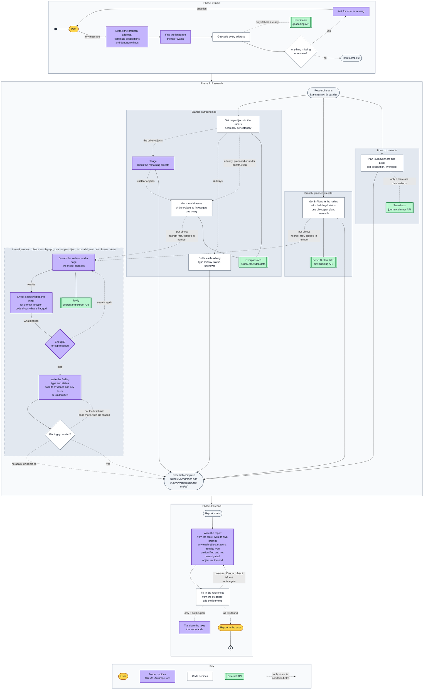
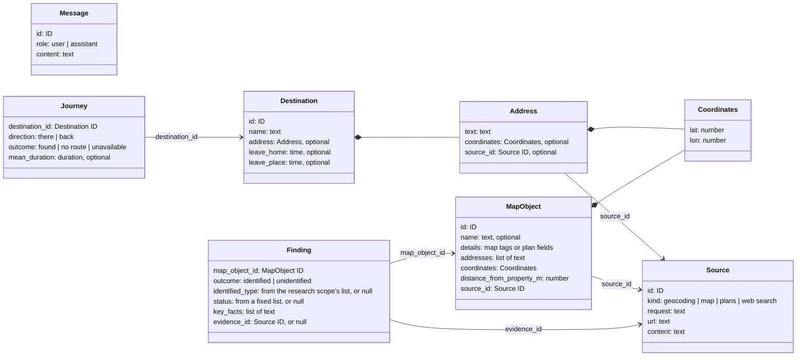

# Architecture

How the agent is built: the flow of a run, the state it keeps and the rules it follows. What
the agent is for: [vision.md](vision.md). Each data source: [sources.md](sources.md).

The agent is built on LangGraph ([ADR 1](adr/0001-langgraph.md)), so the flow and the state
follow its model: one shared state, steps as nodes, parallel branches and pauses for the user.
The graphs exactly as the code compiles them, nodes and edges only, are in
[compiled-graph.md](compiled-graph.md).

## One run

A run has three phases. All steps share one run state: each step reads it and writes its
result to it. Each investigation is a subgraph with its own state (see
[The investigation subgraph](#the-investigation-subgraph)). Only the state passes between
phases; separate conversations share no state. The flowchart does not show the state; the table
[What each step reads and writes](#what-each-step-reads-and-writes) does.

1. **Input** is one loop for any first message: a greeting, an address alone or a full
   request.
   - The model picks out only what the user's messages add to the input so far or change in
     it, never coordinates: usually the last message, but also an earlier answer that the
     input misses. Code applies these changes; everything else stays as it was, destination
     IDs included.
   - After each message, a model call reads all of the user's messages, without the agent's
     questions, and names the language the user wants the answers in: later messages count
     more, and a pasted listing and addresses do not count. The agent writes in that
     language, the questions and the report alike, and in English if the messages do not
     show it, such as messages with only an address.
   - After each message, code geocodes every address again and never changes its text. The
     new result replaces the old one. An address gets coordinates only if there is exactly
     one precise match. If nothing matches, several places match, or the match is only a
     street or a district, the user is asked. If Nominatim is down, the run stops (see
     [Failures](#failures)).
   - Code, not the model, checks that the input is complete: the property is resolved and in
     Berlin, the user has said where they travel, and each destination is resolved and has
     both departure times. A destination may be outside Berlin.
   - The user may name at most two destinations by default (`OUT_OF_FRAME_MAX_DESTINATIONS`).
     A longer list makes code ask which to keep, before geocoding; code never drops one itself.
   - What is not known yet is not written. A vague time such as "in the morning" stays empty,
     and a destination announced but not described ("I will send the second one later") gets
     a name only. The model asks for what is missing or unclear, for example which of several
     matching addresses is meant.
2. **Research** starts when the input is complete. An object is one thing near the property:
   a site from the map, or a planned object from a B-Plan (*Bebauungsplan*, a binding
   development plan). Code fetches objects by the categories of the research scope; each
   category is searched in a circle around the property, with the category's own radius. The
   object has no category field: code puts the category into its `details`, next to the
   fields of its source; no model sees it. An object is in the circle if its nearest edge
   is; distances are always measured to the nearest edge. An object without a finding is
   unclear. Code keeps the nearest five objects per map category and the nearest five plans, by
   default, and the report says so. Every unclear one of them is investigated, whether code or
   triage sends it, so five is also the cap of investigations per category. An
   investigation stops when its evidence is enough, or when it reaches its cap of tool calls;
   one source can be enough. Every branch runs to its end, even with nothing to do; its result
   is then empty.
   - *Surroundings:* one Overpass query returns the map elements of each category
     within the category's circle. Code groups the elements into objects (one site or one road
     can be several elements) and keeps the nearest N per category. An element without a name
     whose centre lies inside the area of a larger element of its category, such as a building
     inside its site, is part of that element; a named one, such as a factory inside an
     industrial area, is an object of its own. Elements of one category are one object when they have the same name, or without
     a name the same `ref`, such as a road number, and the same stage: built, under
     construction or proposed. A road and a railway are never one object. The road elements of
     one stage that have neither name nor `ref` are one object, and so are such rail elements,
     such as service tracks; any other element without a name is an object of its own. An
     object keeps the ID, details and coordinates of its nearest element, and that element's
     distance; its addresses come from that element's area. Code sends every
     `industry` object and any other object tagged as proposed or under construction to
     investigation, within the cap, but not a railway: code gives every railway the type
     railway and an unknown status, since no page that the agent can search shows reliably
     whether trains run on a line now.
     The model triages only the rest, one per call, from the name, tags and what it knows.
     If these are enough to fill the finding without conflicts, it writes it with the map's
     status; otherwise it sends the object to investigation. These findings use the map
     without a web check. Then a second query returns the addresses of the buildings inside
     each object that goes to investigation, whoever sent it; the other objects get none, which
     spares the busy public instance. If that query fails, the objects are investigated
     without addresses.
   - *Planned objects:* the Berlin B-Plan WFS, the city's planning API, filters only by a
     rectangle. Code asks for the square around the circle, drops the plans outside the
     circle and keeps the nearest N. The WFS gives each plan's legal status and, for plans in
     force, the permitted land use. These are fixed values and dates, and none shows whether
     building has started, so a model could only guess. There is no triage, so every plan is
     unclear. An old plan is not excluded: it can still cover land that is not built.
   - *Commute:* for each destination, code asks Transitous for two journeys on a normal
     weekday: there, when the user leaves home, and back, when they leave the destination.
     Each journey is the mean of the next three connections, or of fewer if fewer are found.
     Each direction has an outcome: found, no route or unavailable. Each destination has its
     own times, so two people with different schedules are two destinations.
3. **Report.** Unidentified and not investigated objects are not removed; they are listed at
   the end. Code fills in the references (see [Grounding](#grounding)) and adds the journeys:
   each with its destination, direction, the time the user leaves and mean duration, or why
   it has none. They are plain data, so no model writes them. Code also adds which kinds of
   objects the report covers and what a development plan is, and the credits the licences
   require: "© OpenStreetMap contributors" with its link, and a link to the Transitous sources
   page if there are journeys. The model writes the report in Markdown sections: the
   identified objects, the identified plans, and the objects that could not be identified or
   were not investigated. Code adds the title, a line that a language model wrote the report
   and its facts should be checked against the sources, and the parts above under headings of
   their own. The model writes the report in the user's language. The texts that code adds
   are in English, with placeholders, such as the address or a time, that code fills in. For
   another language, a model call translates these texts, and code checks that each
   translation is not empty and keeps its placeholders; if one does not, they all stay in
   English. So no value of the run, such as the address, a time or a link, passes through the
   translation. The credits that the licences require stay in
   English, word for word.

## The state

The state is the full record of one run, described as a logical data model: records, fields
and plain types, not the classes of a language or a framework. A step gets only part of it
(see [What each step reads and writes](#what-each-step-reads-and-writes)). Eval tasks start
from run states in this model. It defines what matters for the flow; exact formats and
validation are left to the code.

- **Updates.** A step returns only the fields it changes. Each field has a reducer: it says
  how an update is combined with the current value. Parallel branches add entries to the same
  lists, such as `sources` and `map_objects`; without a reducer, LangGraph rejects such updates.
  A map object with the ID of one already in the list replaces it, so that code can add its
  addresses later. In
  the input phase, code first applies the user's changes, then replaces `property` and
  `destinations` with the result.
- **Saved after each step.** A run can stop to ask the user and continue later, so the state
  holds only data.
- **No flags in the state.** Code computes them when it needs them, for example what is still
  missing in the input or which unclear objects were not investigated. Values that code
  computes once from a source response are stored: coordinates, `distance_from_property_m` and
  `mean_duration`.
- **IDs only where needed.** A record has an ID only if something refers to it. Code creates
  every ID; the model never does.
- **Source data as it comes.** A map object keeps the fields of its source in `details`,
  unparsed, and the model reads them. A record has a field of its own only where code uses
  it: an ID, a name, coordinates, a distance, a source.

| Field | Type | Contents | Reducer |
|---|---|---|---|
| `messages` | list of Message | The input conversation and finished report | Append; a message with a known ID replaces the old one |
| `language` | text, or null | The language the user wants the answers in, by its name in English; null if the messages do not show it, and the agent writes in English then | Replace |
| `property` | Address, or null | The property, in Berlin; null until the user gives its address | Replace |
| `destinations` | list of Destination, or null | The places the user travels to, with departure times; null until the user answers, an empty list if they travel nowhere | Replace the whole list, so a correction wins |
| `sources` | list of Source | Geocoding, map and plan responses, plus Tavily snippets and pages cited by findings | Append |
| `map_objects` | list of MapObject | Map objects and B-Plans, nearest N per category; N is set in the configuration, separately for map categories and plans | Append; an object with a known ID replaces the old one |
| `findings` | list of Finding | One per clear or investigated object | Append |
| `journeys` | list of Journey | Two per destination, there and back, each with its outcome | Append |
| `failures` | list of service | The services that still failed after retries: map, plans, transit or web search | Add if new |
| `report` | text | The report | Replace |

*Null* means no value; an *optional* field can be null. In the input, null means not known
yet: `destinations: null` means the user has not answered, while `[]` means they travel
nowhere.

Messages use LangChain `HumanMessage` and `AIMessage` records. Questions are saved before
`interrupt()` pauses the graph; an answer resumes it with `Command(resume=...)`. The finished
report is an AI message with the stable ID `final-report`, added only after references,
credits and translated text. Replaying that step replaces the message. The `report` field
stays available to the CLI and evals; old saved `{role, text}` messages still load.

The caller supplies the checkpointer: memory for the CLI and evals; a server can supply a
lasting one, such as PostgreSQL.

`Address.source_id` points to the Nominatim response for this address. If the address is not
found, or several places match it, code uses this response to build the question for the user.

A `Source` is one API response, or one snippet or page from Tavily, with the text that was
retrieved. Each snippet or page is a separate source.

A `Journey` has a duration only when its outcome is found. The transit response is not kept
in the state: code computes the duration from it at once.

`MapObject.addresses` lists the street addresses of the buildings inside a map area, from
OpenStreetMap, for an object that is investigated. It is empty for any other object, and for
a road, a railway or a B-Plan. An unnamed object cannot be found on the web by its
coordinates, but it can by its address.

Only a `Finding` classifies an object: its `identified_type` and `status` come from the lists
in the research scope.

The lists of finding types and statuses are in
[research_scope.yaml](../src/out_of_frame/data/research_scope.yaml). Each type also says how
such an object can affect people nearby, and the report takes the effect from it alone. The
agent and the evals use the same lists; the agent never sees the truth labels. A plan uses
the same lists: its type is what the plan allows, and its status says whether building has
started. The plan's legal status, in procedure or in force, stays in its own data.

### What each step reads and writes

One row per flowchart step, in the same order and with the same name; the investigation is
one row, and its own steps are in [The investigation subgraph](#the-investigation-subgraph).
A step reads and writes only the fields listed for it; no model step gets the whole state.
`a.b` is a field inside a record, and `[]` means every entry of a list. The user's first
message is the input of the run and goes straight into `messages`.

| Phase | Step | Who | Reads | Writes |
|---|---|---|---|---|
| Input | Extract the property address, commute destinations and departure times | model + code | `messages`, `property.text`, `destinations[]` without `address.coordinates` and `address.source_id` | `property.text`, `destinations[]`: `id`, `name`, `address.text`, `leave_home`, `leave_place` |
| Input | Find the language the user wants | model | the user's `messages`, without the agent's questions | `language` |
| Input | Geocode every address | code | `property.text`, `destinations[]` (only `address.text` is geocoded) | `property.coordinates`, `property.source_id`, `destinations[].address.coordinates`, `destinations[].address.source_id`, `sources` |
| Input | Anything missing or unclear? | code | `property`, `destinations`, the geocoding `sources` they point to | nothing |
| Input | Ask for what is missing | model | `messages`, `language`, and what is missing, computed by code | `messages`: the question and the user's answer |
| Research | Get map objects in the radius | code | `property.coordinates` | `map_objects`, `sources`, `failures` |
| Research | Triage | model + code | one remaining map object per call: `id`, `source_id`, and the kind of the `sources` entry that it names, which keeps plans out (code); `name`, `details` without the category (model) | `findings` for clear objects; code sets `map_object_id` and `evidence_id` |
| Research | Get the addresses of the objects to investigate | code | `map_objects`, `findings`: which objects go to investigation, computed by code; the kind of the `sources` entry that each one's `source_id` names: only map objects have addresses; each one's element in that map response, which gives its OSM type, ID and tags | `map_objects[].addresses` of those objects |
| Research | Get B-Plans in the radius | code | `property.coordinates` | `map_objects`, `sources`, `failures` |
| Research | Investigate each object, one run per object | model + code | one entry of `map_objects`, and the kind of the entry of `sources` that its `source_id` names | one entry of `findings`, the source it cites, `failures` |
| Research | Plan journeys there and back | code | `property.coordinates`, `destinations[]`: `id`, `address.coordinates`, `leave_home`, `leave_place` | `journeys`, `failures` |
| Report | Write the report | model + code | code reads the kind of the `sources` entry that each object's `source_id` names, which marks plans; model reads `language`, `map_objects` without the category, `findings`, `failures` other than transit; on a retry, the unknown IDs and the objects left out (code) | `report` |
| Report | Fill in the references | code + model | `report`, `findings[]`: `map_object_id`, `evidence_id`, `sources`, `journeys`, `destinations[]`: `id`, `name`, `leave_home`, `leave_place` (code); if `language` is not English, a model call translates the texts that code adds, from those texts alone, never the state, and code checks their placeholders (model) | `report`, `messages`: the finished report with ID `final-report` |

### The investigation subgraph

Each investigation is a LangGraph subgraph with its own state. Code starts one run per unclear
object, in parallel, with `Send`, LangGraph's way to run a node once per item. A run gets its
object and the kind of the source that the object comes from, map or plans: a plan gets its own
prompts. The model sees the object's name, details without the category, and addresses, not its coordinates or
distance: it searches by address, or a plan by its number. The run's field names differ from the run state's, so nothing passes between them by
accident. When it ends, code writes its finding into `findings`, the snippet or page the
finding cites into `sources`, if it cites one, and web search into `failures` if it failed.

The model has two tools, which code runs with Tavily: search, which returns short snippets,
and extract, which returns the full text of one page it chooses. One model call makes both choices: it calls a
tool to search again, or answers without one to stop. A separate model call checks every
snippet and page for prompt injection before it is stored, and code drops what it flags (see
[Prompt injection](#prompt-injection)); the model never sees flagged content.

| Field | Type | Contents | Reducer |
|---|---|---|---|
| `map_object` | MapObject | The object under investigation | Replace |
| `source_kind` | map or plans | The kind of the source that the object comes from: a plan gets its own prompts | Replace |
| `history` | list of messages | The model's tool calls and the results it was shown | Append |
| `pages` | list of Source | Snippets and pages that passed the check, each with an ID | Append |
| `finding` | Finding, or null | The finding; a rejected one is written once more, and replaced with an unidentified one if rejected again | Replace |
| `web_search_failed` | bool | Whether web search failed; the finding is then unidentified | Replace |
| `rejection` | text, or null | Why the first finding was rejected, for the model's second try | Replace |

| Step | Who | Reads | Writes |
|---|---|---|---|
| Search the web or read a page | model + code | `map_object`, `source_kind`, `history`, `pages` | `history`: the tool call, which code runs; if web search fails, `web_search_failed` and `finding` as unidentified |
| Check each snippet and page for prompt injection | model + code | each snippet and page the tool returned | `history` and `pages`: only what passes (code) |
| Enough? or cap reached | model + code | `map_object`, `source_kind`, `history`, `pages`; code counts the tool calls | nothing |
| Write the finding | model + code | `map_object`, `source_kind`, `history`, `pages`, `rejection` | `finding`, unset if the answer has no Finding tool call; code sets `map_object_id` |
| Finding grounded? | code | `finding`, `map_object.name`, `map_object.details`, `map_object.addresses`, `map_object.source_id`, `pages`, `rejection` | if not, the first time `rejection`, and the finding is written once more; the second time `finding` as unidentified; at the end, the three run-state fields |

## Who decides

Code decides what runs next, by fixed rules over the state. The model changes the path only
through what it writes into the state; there is no LLM router. The one exception is the
investigation loop: the model decides to search again or stop, within a fixed number of tool
calls per object.

Other rules:

- **Only the investigation has tools: Tavily search and extract.** Map, plan and transit
  queries are fixed, with fixed radii.
- **The model has no clock.** Code passes the current date to each step that needs it: an
  investigation, the journey planner and the report. Evals pass the task's date instead. The
  date is not kept in the state, because a run can wait days for the user's answer. Status
  comes only from sources, never from the model's memory; in triage, that source is the map.

## Grounding

Code gives an ID to each source response and to each snippet or page from Tavily. A snippet or
page reaches the run state only if a finding cites it. A finding rests on one source, the
page that best settles the object, and on the object's own map or plan data: it cites that
source's ID, or the map or plan response's ID when no page adds a fact the finding needs, and
its key facts (a name, a date, a status), copied word for word from the source or the map or
plan data. One source keeps the facts of one business apart from another's at a
shared site, and lets the report cite one page for an object. A search snippet and the full
text of the same page, with the same URL, count as one page. Code checks that the ID exists,
that an unidentified finding cites no page, that a cited page gives at least one key fact, and
that each fact's words, numbers and symbols appear in the stored text in the same order,
whatever the case, spacing and punctuation between them; for the object's own map or plan
data, that text is the object's name, details without the category, and addresses. If not,
or if the answer has no Finding tool call, the finding is rejected, and the model writes it
once more, told why; a second rejection marks the object unidentified, so that it does not
stop the run. The check runs inside the investigation, so only a finding that passes it, or an
unidentified one after a second rejection or a web search failure, goes into `findings`.
Triage findings
are not checked: in triage the model
may use what it knows to say what a mapped object is.

The report cites a finding by its object ID, never by a link. Code replaces each citation with
links a person can open. A web page is linked by its URL and named by its site, such as
bsr.de. A map object is linked by its own page on OpenStreetMap, and a plan by its own
document where the B-Plan WFS links one; a plan without one is named by its source, the
Berlin B-Plan WFS. An object always cites its own map or plan data as well as the page of its
finding, since the report also gives facts from that data, such as the object's name. An unknown ID, an object ID in the
text outside a citation, which the reader cannot use, or an object that the report leaves out
sends the report back to be written again, a few times at most; after that the run stops, as
when the model fails. So the model cannot invent a reference or drop an object.

## Prompt injection

Only web pages can bring in prompt injection: text written to give the model instructions.
Map and plan data are trusted. The user's messages reach only the input phase, and later
phases get only addresses, names, times and the name of a language from it. The model gives
that name in free form, so a user could put other words into it; they would change only their
own report.

Before the investigation model sees a snippet or a page, a separate model call checks it for
instructions aimed at the model. This checker has no tools and answers only yes or no, so
injected text can at most make it pass the content. Flagged content is dropped and logged, and
the investigation goes on with the rest.

If an injection gets through, code still limits it: the investigation model's only tools are
Tavily search and extract, tool calls are capped, and every fact in a finding must appear in a
stored source. False facts on a page can still mislead the model. Evals plant instructions in
test pages to check these guards; they cannot measure how often attacks happen in the real
world.

## Failures

Code retries each call to the model or a source a few times. If it still fails:

- **The model or geocoding:** the run stops, and the user is asked to try again later. The
  state is saved after each step, so with a lasting checkpointer a retry continues where the
  run stopped (see [the state](#the-state)). The CLI's checkpointer is in memory, so the CLI
  starts a new run.
- **The map or plan source:** that part of the report is missing, and the rest continues.
  The query for the addresses of the objects to investigate is the exception: they are
  investigated without addresses, the map part of the report stays, and nothing is added to
  `failures`.
- **The transit source:** the journeys it could not plan are marked unavailable, and the
  rest continues.
- **Web search in an investigation:** the object stays unidentified, and the other
  investigations continue.

The translation of the texts that code adds to the report is the exception among model calls:
a failed call, an answer that is cut off or does not parse, or a translation that does not fit
leaves all of them in English. The report still comes out.

In the last three cases, code adds the service to `failures` and at once shows the user one
fixed sentence per failed service, for example "Development plans could not be loaded, so the
report may be incomplete." The sentence goes through the LangGraph stream, not through the
state or the model. The model reads `failures` only so that it never says "nothing found"
there.

An empty answer is not a failure: an address with no match leads to a question, an empty map
adds no objects, and no connections give a journey with no route.

Details such as status codes and retries go only to logs and traces. The flowchart does not
show these paths.
