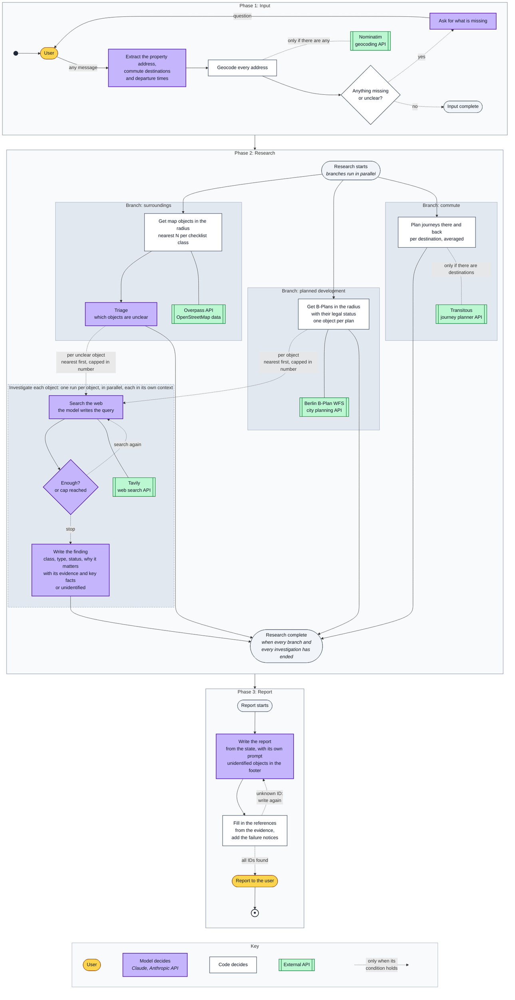
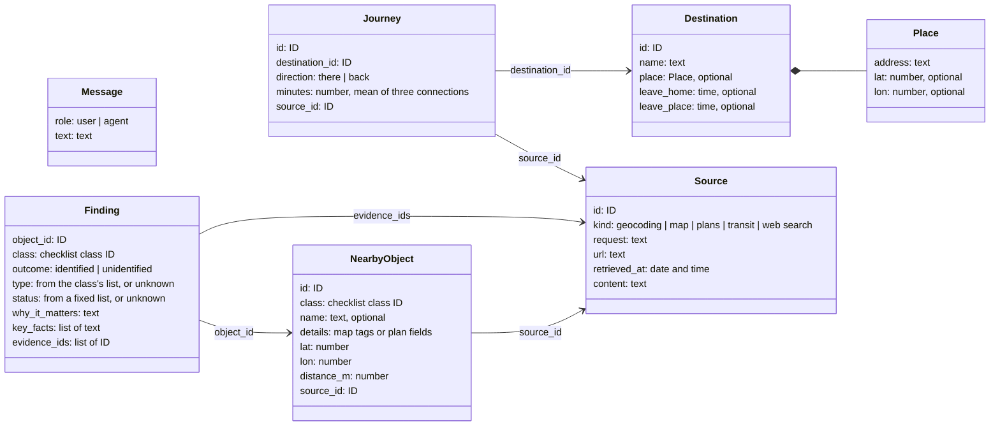

# Architecture

How the agent is built: the flow of a run, the state it keeps and the rules it follows. What
the agent is for: [vision.md](vision.md). Each data source: [sources.md](sources.md).

## One run

A run has three phases. All steps share one state: each step reads it and writes its result
to it. Only the state passes between phases, and nothing is kept for the next run. The
flowchart does not show the state; the table
[What each step reads and writes](#what-each-step-reads-and-writes) does.

1. **Input** is one loop for any first message: a greeting, an address alone or a full
   request.
   - The model writes only what the user added or corrected in this message, and never
     coordinates.
   - Code then geocodes every address and never changes an address. A place is resolved when
     it has coordinates.
   - Code, not the model, checks that the input is complete: the property is resolved and in
     Berlin, the user has said where they travel, and each destination is resolved and has
     both departure times. A destination may be outside Berlin.
   - What is not known yet is not written. A vague time such as "in the morning" stays empty,
     and a destination announced but not described ("I will send the second one later") gets
     a name only. The model asks for what is missing or unclear, for example which of several
     matching addresses is meant.
2. **Research** starts when the input is complete. An object is one thing near the property
   in one checklist class: a site from the map, or a planned development from a B-Plan
   (*Bebauungsplan*, a binding development plan). Each class is searched in a circle around
   the property, with the class's own radius. An object is in the circle if its nearest edge
   is; distances are always measured to the nearest edge. An object without a finding is
   unclear. Unclear objects are investigated nearest first, at most five per class; the rest
   are listed in the report as not investigated. Every branch runs to its end, even with
   nothing to do; its result is then empty.
   - *Surroundings:* one Overpass query returns the map elements of each checklist class
     within the class's circle. Code groups them into objects (one site or one road can be
     several elements) and keeps the nearest N per class. Map names and tags are free text, so
     the model triages them: clear objects become findings as they are, unclear ones are
     investigated.
   - *Planned development:* the Berlin B-Plan WFS, the city's planning API, filters only by a
     rectangle. Code asks for the square around the circle and drops the plans outside the
     circle. The WFS gives each plan's legal status and, for plans in force, the permitted
     land use. These are fixed values and dates, and none shows whether building has started,
     so a model could only guess. There is no triage, so every plan is unclear. An old plan
     is not excluded: it can still cover land that is not built.
   - *Commute:* for each destination, code asks Transitous for two journeys on a normal
     weekday: there, when the user leaves home, and back, when they leave the destination.
     Each journey is the mean of the next three connections. Each destination has its own
     times, so two people with different schedules are two destinations.
3. **Report.** Unidentified objects are not removed; they are listed at the end. Code fills in
   the references (see [Grounding](#grounding)).

## The state

The state is the record of one run, described as a logical data model: records, fields and
plain types, not the classes of a language or a framework. Eval tasks start from run states in
this model.

- **Updates.** A step returns only the fields it changes. Parallel branches add entries to the
  same lists, such as `sources` and `objects`, so each field has a merge rule: otherwise one
  branch's list would replace another's.
- **Saved after each step.** A run can stop to ask the user and continue later, so the state
  holds only data.
- **No derived values.** Code computes them when it needs them, for example what is still
  missing in the input, or which unclear objects were not investigated.

| Field | Type | Contents | Merge rule |
|---|---|---|---|
| `messages` | list of Message | The conversation in the input phase | Append |
| `property` | Place, or null | The property, in Berlin; null until the user gives its address | Replace |
| `destinations` | list of Destination, or null | The places the user travels to, with departure times; null until the user answers, an empty list if they travel nowhere | Replace the whole list, so a correction wins |
| `sources` | list of Source | Every source response and search result | Append |
| `objects` | list of NearbyObject | Map objects and B-Plans, nearest N per class | Append |
| `findings` | list of Finding | One per clear or investigated object | Append |
| `journeys` | list of Journey | Two per destination: there and back | Append |
| `failures` | list of source kind | The sources that still failed after retries: map, plans, transit or web search | Add if new |
| `report` | text | The report | Replace |

*Null* means not known yet; an *optional* field can be null. An empty list is an answer, not
null.

An investigation has its own state: the object, the searches so far and their results. Only
the finding and the sources it cites go into the run state.

### What each step reads and writes

In flowchart order. A step reads and writes only the fields listed for it; no model step gets
the whole state.

| Phase | Step | Who | Reads | Writes |
|---|---|---|---|---|
| Input | The user's message | user | nothing | `messages` |
| Input | Extract the property address, destinations and departure times | model | `messages`, `property`, `destinations` | `property`, `destinations` |
| Input | Geocode every address | code | `property`, `destinations` | `property`, `destinations`, `sources` |
| Input | Anything missing or unclear? | code | `property`, `destinations` | nothing |
| Input | Ask for what is missing | model | `messages`, and what is missing, computed by code | `messages` |
| Research | Get map objects | code | `property` | `objects`, `sources`, `failures` |
| Research | Triage | model | `objects` (map objects) | `findings` |
| Research | Get B-Plans in the radius | code | `property` | `objects`, `sources`, `failures` |
| Research | Investigate one object | model | one entry of `objects` | `findings`, `sources`, `failures` |
| Research | Plan journeys | code | `property`, `destinations` | `journeys`, `sources`, `failures` |
| Report | Write the report | model | `destinations`, `objects`, `findings`, `journeys`, `failures` | `report` |
| Report | Fill in the references, add the failure notices | code | `report`, `findings`, `journeys`, `sources`, `failures` | `report` |

## Who decides

The model decides:

- in the input phase: what the message says and how to ask for what is missing;
- in triage: which map objects are unclear;
- in an investigation: what to search for, whether to search again and what the finding is;
- in the report: what to highlight and how to say it.

Code decides what runs next, by fixed rules over the state. The model changes the path only
through what it writes into the state; there is no LLM router. The one exception is the
investigation loop: the model decides to search again or stop, within a fixed number of
searches per object.

Other rules:

- **The model's only tool is web search.** Map, plan and transit queries are fixed, with
  fixed radii.
- **The model has no clock.** Code passes the current date to each step that needs it: an
  investigation, the journey planner and the report. Evals pass the task's date instead. The
  date is not kept in the state, because a run can wait days for the user's answer. Status
  comes only from dated sources, never from the model's memory.

## Grounding

Code stores every source response and search result with an ID. A finding cites the IDs it
uses and its key facts (a name, a date, a status), copied exactly from the source. Code checks
that each ID exists and each fact appears in the stored text. If not, the finding is rejected:
the agent searches more, within the object's search limit, or marks the object unidentified.

The report cites a finding by its object ID and a journey by its ID, never by a link. Code
replaces each ID with its sources: the link, the title and the date. An unknown ID sends the
report back to be written again. So the model cannot invent a reference.

## Prompt injection

Web pages may contain prompt injection: text written to give the model instructions. It
reaches only the investigation that ran the search. There the model's only tool is web search,
searches are capped, and every fact must appear in a stored source. False facts on a page can
still mislead the model; evals measure how often.

## Failures

Code retries each call to the model or a source a few times. If it still fails:

- **The model or geocoding:** the run stops, and the user is asked to try again later. The
  state is saved after each step, so the run then continues where it stopped.
- **The map, plan or transit source:** that part of the report is missing, and the rest
  continues. Code adds the source to `failures`. The model reads them, so it never says
  "nothing found" there. Code adds one fixed sentence per failed source to the report, for
  example "Development plans could not be loaded, so the report may be incomplete."
- **Web search in an investigation:** the object stays unidentified, and the other
  investigations continue. Web search is added to `failures` once.

Details such as status codes and retries go only to logs and traces. The flowchart does not
show these paths.
