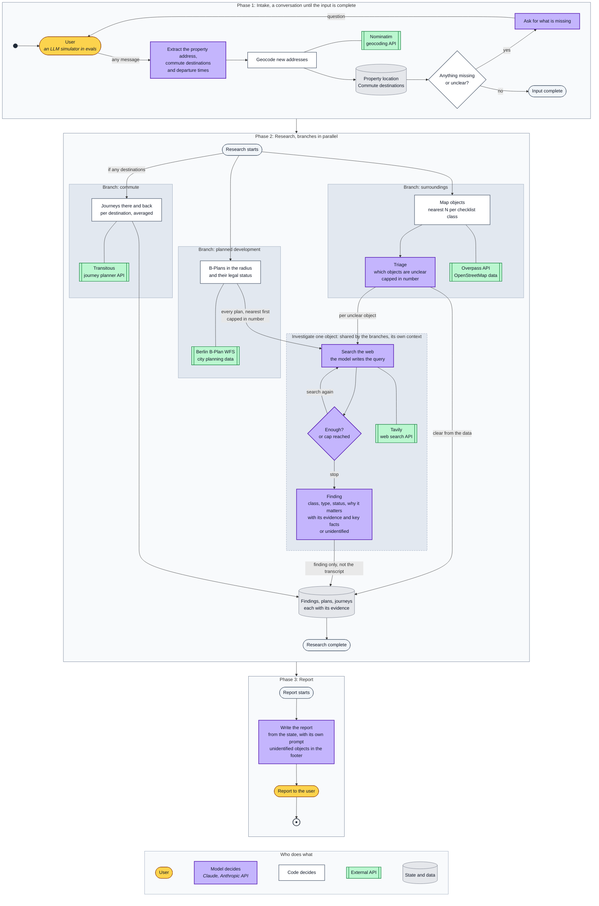
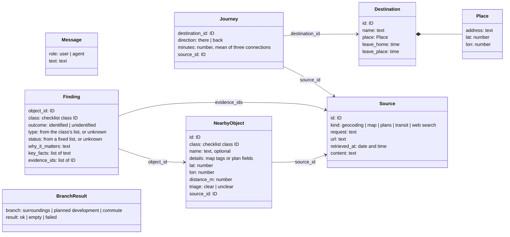

# Architecture

How the agent is built: the flow of a run, the state it keeps and the rules it follows.

## One run

A run has three phases and one state. Only the state passes from one phase to the next.
Nothing is kept for the next run.

1. **Intake** is one loop for any first message: a greeting, an address alone or a full
   request. The model finds the property address, the places the user travels to and the
   departure times in the message. Code geocodes each new address, saves it in the state and
   checks what is still missing or unclear. The model then asks the user for it. If an
   address is ambiguous, the user gets a question. The property must be in Berlin; a place
   the user travels to may be outside it. After intake, the property is
   stored as one point (latitude and longitude). The code that calls each source converts
   this point to the format that source needs; the Berlin WFS, for example, needs a bounding
   box around it. Coordinates are converted only in code.
2. **Research** runs in parallel branches after the input is complete.
   - *Surroundings:* one Overpass query returns the map elements of each checklist class,
     each class within its own radius. Code groups the elements into objects (one site or one
     road can be several elements), measures the distance to each object and keeps the
     nearest, up to a fixed number per class. The model marks each object as clear or unclear.
     Clear objects go into the state as they are. Unclear objects are investigated, nearest
     first, at most five per class; the rest are listed in the report as not investigated.
   - *Planned development:* one query to the Berlin B-Plan WFS. It gives each plan's legal
     status and, for plans in force, the permitted use of the land. It never shows whether
     building has started, so there is no triage here: code marks every plan as unclear.
     Plans are investigated like unclear map objects, nearest first, at most five; the rest
     are listed in the report as not investigated. The age of a plan does not exclude it: an
     old plan can still cover land that is not built.
   - *Commute:* only if the user named places they travel to regularly. Each place has its
     own times, so two people with different schedules give two entries. For each place, code
     asks Transitous for two journeys on a normal weekday: there, at the time the user usually
     leaves home, and back, at the time they usually leave the place. Each journey is the
     average of the next three connections.
3. **Report.** The model writes the report from the state, with its own prompt. Objects that
   could not be identified are listed at the end of the report. They are not removed.

## The state

The state is the record of one run. It is described here as a logical data model: records,
fields and plain types, not the classes of a language or a framework. The run states that eval
tasks start from use this model.

- **Updates.** A step reads the state and returns only the fields it changes. The research
  branches run in parallel and can change the same field, so each field has a merge rule.
- **Saved after each step.** A run can stop to ask the user and continue later, so the state
  holds only data.
- **No derived values.** Code computes them from the state when it needs them: for example,
  what is still missing in intake, or which unclear objects were not investigated.
- **Sources are kept in the state.** Code decides which part of the state each model step
  gets. No model step gets the whole state.

| Field | Type | Contents | Written by | Merge rule |
|---|---|---|---|---|
| `run_date` | date | The date of the run; the agent has no clock | Run input | Replace |
| `messages` | list of Message | The intake conversation | Intake | Append |
| `property` | Place | The property, in Berlin | Intake | Replace |
| `destinations` | list of Destination | The places the user travels to, with departure times | Intake | Replace the whole list, so a correction wins |
| `sources` | list of Source | Every source response and search result | Every step that calls a source | Merge by ID |
| `objects` | list of NearbyObject | Map objects and B-Plans, nearest N per class | Surroundings, planned development, triage | Merge by ID |
| `findings` | list of Finding | One per clear or investigated object | Triage for clear map objects; the investigation for unclear objects | Merge by object ID |
| `journeys` | list of Journey | Two per destination: there and back | Commute | Append |
| `branches` | list of BranchResult | The result of each research branch | Each research branch | Merge by branch |
| `report` | text | The report | Report | Replace |

*Replace* keeps the newest value. *Append* adds to the list. *Merge by ID* adds new entries
and replaces an entry with the same ID.

An investigation has its own state: the object, the searches so far and their results. This
state is not part of the run state. When the investigation ends, only the finding and the
sources it cites go into the run state.

## Who decides

The model decides:

- in intake: what the message contains (addresses, places, times) and how to ask for what is
  missing;
- in triage: which map objects are unclear;
- in an investigation: what to search for, whether to search again, and what the finding is;
- in the report: what to highlight and how to say it.

Triage covers map objects only. Map names and tags are free text, and reading them needs
judgement. B-Plan fields are fixed values and dates, and none of them shows whether building
has started. A model would see nothing more than code does and could only guess from its
memory. So code sends every B-Plan to investigation.

Code decides what runs next. It reads the state and follows fixed rules: it asks the user
when something is missing, starts one investigation per unclear object, and plans journeys
for each place the user named. The model changes the path only through what it writes into
the state. There is no LLM router.

The one exception is the investigation loop: there the model itself decides to search again
or stop, with at most a fixed number of web searches per object.

Other rules:

- **The model writes no queries for the map, plan or transit sources.** These sources run
  fixed queries with fixed radii. The model's only tool is web search.
- **Each investigation runs in its own context.** Only the finding and its evidence IDs return
  to the state, not the full transcript.
- **The agent has no clock.** Each run gets the date as input. Status comes only from dated
  sources, never from the model's memory.

## Grounding

Every finding must be grounded in stored sources. Code gives every source response and search
result an ID and stores it. A finding cites the IDs it uses and its key facts (a name, a date,
a status), written exactly as in the source. When a finding is written, code checks that each
ID exists and that each fact appears in the stored text. If the check fails, the finding is
rejected. The agent then searches more, within the object's search limit, or marks the object
as unidentified. Code fills in the references in the report from the evidence, so the model
cannot invent one.

## Prompt injection

Search results come from other websites and may contain prompt injection: text written to
give the model instructions. This text reaches only the investigation that ran the search.
Code limits what it can do: the model's only tool is web search, the number of searches is
capped, and every fact in a finding must appear in a stored source, so it can be traced to its
page. Injected text can still mislead the model, for example with false facts on a page. Evals
measure how often this happens.

## Failures

If a source fails, code tries again. If it still fails, the report marks that branch, and the
other branches continue. "The source failed" and "nothing was found" are different states in
the report.
