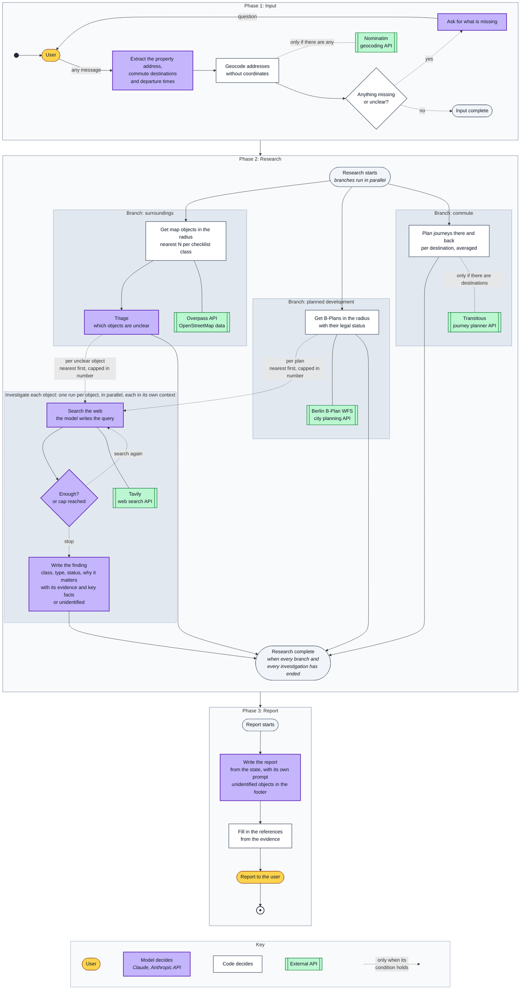
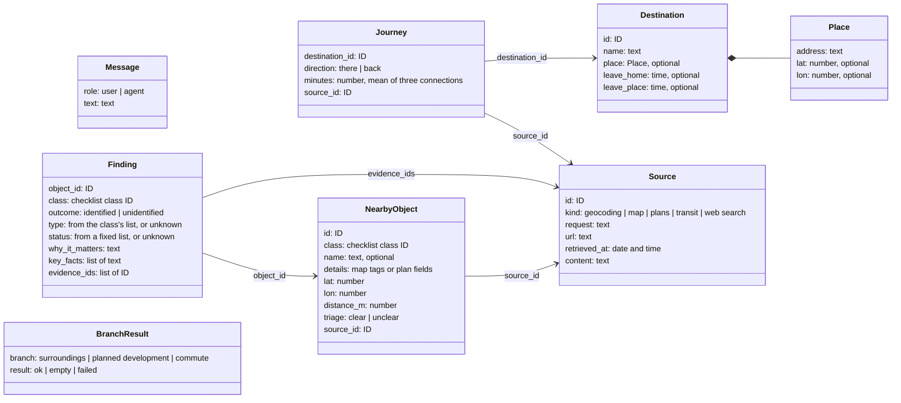

# Architecture

How the agent is built: the flow of a run, the state it keeps and the rules it follows.

## One run

The state is not drawn. Each step reads it and returns only the fields it changes;
[What each step reads and writes](#what-each-step-reads-and-writes) lists the fields.

A run has three phases and one state. Only the state passes from one phase to the next.
Nothing is kept for the next run.

1. **Input** is one loop for any first message: a greeting, an address alone or a full
   request. The model finds the property address, the places the user travels to and the
   departure times in the message. It writes to the state only what changed. "I travel
   nowhere" is written too: it is an answer, not a missing value. The model never writes
   coordinates: a new or corrected address is written without them, and code keeps the
   coordinates of a place whose address did not change. Code then geocodes each address
   that has no coordinates and calls Nominatim only if there is one. It never changes an
   address. A place is resolved when it has coordinates. Then code, not the model, checks
   whether the input is complete: the property is resolved and in Berlin, the user has said
   where they travel, and each place is resolved and has both departure times. A vague time
   such as "in the morning" is not written, so the model asks for a clock time. A place the
   user announces but does not describe yet ("I will send the second one later") is written
   as a destination with a name only, so the input stays incomplete. The model asks for
   anything missing or unclear, for example which of several matching addresses is meant. A
   place the user travels to may be outside Berlin. After the input phase, the property is
   stored as one point (latitude and longitude). The code that calls each source converts
   this point to the format that source needs; the Berlin WFS, for example, needs a bounding
   box around it. Coordinates are converted only in code.
2. **Research** runs in parallel branches after the input is complete. Every branch always
   runs to its end, even with nothing to do; its result is then empty. Research is complete
   when every branch and every investigation has ended.
   - *Surroundings:* one Overpass query returns the map elements of each checklist class,
     each class within its own radius. Code groups the elements into objects (one site or one
     road can be several elements), measures the distance to each object and keeps the
     nearest, up to a fixed number per class. The model marks each object as clear or unclear.
     Clear objects go into the state as they are. Unclear objects are investigated, nearest
     first, at most five per class; the rest are listed in the report as not investigated.
     With no map objects in the radius, there is nothing to triage.
   - *Planned development:* one query to the Berlin B-Plan WFS. It gives each plan's legal
     status and, for plans in force, the permitted use of the land. It never shows whether
     building has started, so there is no triage here: code marks every plan as unclear.
     Plans are investigated like unclear map objects, nearest first, at most five; the rest
     are listed in the report as not investigated. The age of a plan does not exclude it: an
     old plan can still cover land that is not built. With no plans in the radius, nothing is
     investigated.
   - *Commute:* for the places the user travels to regularly. If there are none, code calls
     Transitous for nothing and the branch returns no journeys. Each place has its own times,
     so two people with different schedules give two entries. For each place, code asks
     Transitous for two journeys on a normal weekday: there, at the time the user usually
     leaves home, and back, at the time they usually leave the place. Each journey is the
     average of the next three connections.
3. **Report.** The model writes the report from the state, with its own prompt. Objects that
   could not be identified are listed at the end of the report. They are not removed. Code
   then fills in the references from the evidence (see [Grounding](#grounding)).

## The state

The state is the record of one run. It is described here as a logical data model: records,
fields and plain types, not the classes of a language or a framework. The run states that eval
tasks start from use this model.

- **Updates.** A step reads the state and returns only the fields it changes. The research
  branches run in parallel and can change the same field, so each field has a merge rule.
- **Saved after each step.** A run can stop to ask the user and continue later, so the state
  holds only data.
- **No derived values.** Code computes them from the state when it needs them: for example,
  what is still missing in the input phase, or which unclear objects were not investigated.
- **Sources are kept in the state.** Code decides which part of the state each model step
  gets. No model step gets the whole state.

| Field | Type | Contents | Merge rule |
|---|---|---|---|
| `run_date` | date | The date of the run; the agent has no clock | Replace |
| `messages` | list of Message | The conversation in the input phase | Append |
| `property` | Place, or null | The property, in Berlin; null until the user gives its address | Replace |
| `destinations` | list of Destination, or null | The places the user travels to, with departure times; null until the user answers, an empty list if they travel nowhere | Replace the whole list, so a correction wins |
| `sources` | list of Source | Every source response and search result | Merge by ID |
| `objects` | list of NearbyObject | Map objects and B-Plans, nearest N per class | Merge by ID |
| `findings` | list of Finding | One per clear or investigated object | Merge by object ID |
| `journeys` | list of Journey | Two per destination: there and back | Append |
| `branches` | list of BranchResult | The result of each research branch | Merge by branch |
| `report` | text | The report | Replace |

*Replace* keeps the newest value. *Append* adds to the list. *Merge by ID* adds new entries
and replaces an entry with the same ID. *Null* means not known yet, and an *optional* field
can be null. An empty list is not null: it is an answer.

An investigation has its own state: the object, the searches so far and their results. This
state is not part of the run state. When the investigation ends, only the finding and the
sources it cites go into the run state.

### What each step reads and writes

The steps are listed in the order of the flowchart. A step reads only the fields listed for
it and writes only the fields listed for it.

| Phase | Step | Who | Reads | Writes |
|---|---|---|---|---|
| Start | Start the run | code | nothing | `run_date` |
| Input | The user's message | user | nothing | `messages` |
| Input | Extract the property address, destinations and departure times | model | `messages`, `property`, `destinations` | `property`, `destinations` |
| Input | Geocode addresses without coordinates | code | `property`, `destinations` | `property`, `destinations`, `sources` |
| Input | Anything missing or unclear? | code | `property`, `destinations` | nothing |
| Input | Ask for what is missing | model | `messages`, and what is missing, computed by code | `messages` |
| Research | Get map objects | code | `property` | `objects`, `sources`, `branches` |
| Research | Triage | model | `objects` (map objects) | `objects`, `findings` |
| Research | Get B-Plans in the radius | code | `property` | `objects`, `sources`, `branches` |
| Research | Investigate one object | model | one entry of `objects`, `run_date` | `findings`, `sources` |
| Research | Plan journeys | code | `property`, `destinations`, `run_date` | `journeys`, `sources`, `branches` |
| Report | Write the report | model | `run_date`, `destinations`, `objects`, `findings`, `journeys`, `branches` | `report` |
| Report | Fill in the references | code | `report`, `findings`, `sources` | `report` |

## Who decides

The model decides:

- in the input phase: what the message contains (addresses, places, times) and how to ask
  for what is missing;
- in triage: which map objects are unclear;
- in an investigation: what to search for, whether to search again, and what the finding is;
- in the report: what to highlight and how to say it.

Triage covers map objects only. Map names and tags are free text, and reading them needs
judgement. B-Plan fields are fixed values and dates, and none of them shows whether building
has started. A model would see nothing more than code does and could only guess from its
memory. So code sends every B-Plan to investigation.

Code decides what runs next. It reads the state and follows fixed rules: it asks the user
when something is missing, starts one investigation per unclear object, and plans journeys
for each place the user named. The model changes the path only through what it writes into
the state. There is no LLM router.

The one exception is the investigation loop: there the model itself decides to search again
or stop, with at most a fixed number of web searches per object.

Other rules:

- **The model writes no queries for the map, plan or transit sources.** These sources run
  fixed queries with fixed radii. The model's only tool is web search.
- **Each investigation runs in its own context.** Only the finding and its evidence IDs return
  to the state, not the full transcript.
- **The agent has no clock.** Each run gets the date as input. Status comes only from dated
  sources, never from the model's memory.

## Grounding

Every finding must be grounded in stored sources. Code gives every source response and search
result an ID and stores it. A finding cites the IDs it uses and its key facts (a name, a date,
a status), written exactly as in the source. When a finding is written, code checks that each
ID exists and that each fact appears in the stored text. If the check fails, the finding is
rejected. The agent then searches more, within the object's search limit, or marks the object
as unidentified. Code fills in the references in the report from the evidence, so the model
cannot invent one.

## Prompt injection

Search results come from other websites and may contain prompt injection: text written to
give the model instructions. This text reaches only the investigation that ran the search.
Code limits what it can do: the model's only tool is web search, the number of searches is
capped, and every fact in a finding must appear in a stored source, so it can be traced to its
page. Injected text can still mislead the model, for example with false facts on a page. Evals
measure how often this happens.

## Failures

If a source fails, code tries again. If it still fails, the report marks that branch, and the
other branches continue. "The source failed" and "nothing was found" are different states in
the report.
