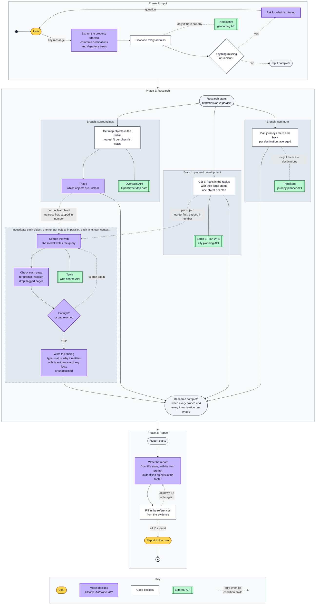
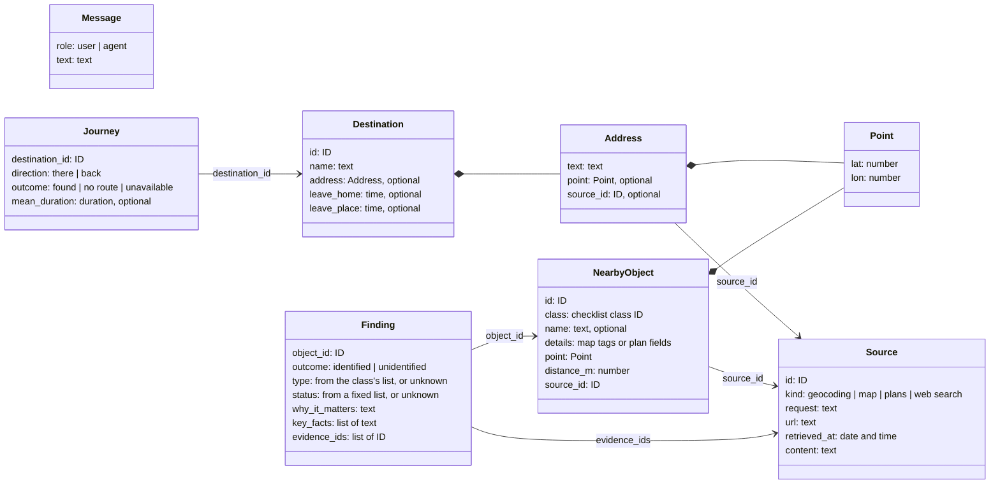

# Architecture

How the agent is built: the flow of a run, the state it keeps and the rules it follows. What
the agent is for: [vision.md](vision.md). Each data source: [sources.md](sources.md).

The agent is built on LangGraph ([ADR 1](adr/0001-langgraph.md)), so the flow and the state
follow its model: one shared state, steps as nodes, parallel branches and pauses for the user.

## One run

A run has three phases. All steps share one state: each step reads it and writes its result
to it. Only the state passes between phases, and nothing is kept for the next run. The
flowchart does not show the state; the table
[What each step reads and writes](#what-each-step-reads-and-writes) does.

1. **Input** is one loop for any first message: a greeting, an address alone or a full
   request.
   - The model picks out only what the user added or changed in this message, never
     coordinates. Code applies these changes; everything else stays as it was, destination
     IDs included.
   - After each message, code geocodes every address again and never changes its text. The
     new result replaces the old one. An address gets coordinates only if there is exactly
     one precise match. If nothing matches, several places match, or the match is only a
     street or a district, the user is asked. If Nominatim is down, the run stops (see
     [Failures](#failures)).
   - Code, not the model, checks that the input is complete: the property is resolved and in
     Berlin, the user has said where they travel, and each destination is resolved and has
     both departure times. A destination may be outside Berlin.
   - What is not known yet is not written. A vague time such as "in the morning" stays empty,
     and a destination announced but not described ("I will send the second one later") gets
     a name only. The model asks for what is missing or unclear, for example which of several
     matching addresses is meant.
2. **Research** starts when the input is complete. An object is one thing near the property
   in one checklist class: a site from the map, or a planned development from a B-Plan
   (*Bebauungsplan*, a binding development plan). Each class is searched in a circle around
   the property, with the class's own radius. An object is in the circle if its nearest edge
   is; distances are always measured to the nearest edge. An object without a finding is
   unclear. Unclear objects are investigated nearest first, at most five per class; the rest
   are listed in the report as not investigated. An investigation stops when its evidence is
   enough and passes the grounding check, or when it reaches its search cap; one source can be
   enough. Every branch runs to its end, even with nothing to do; its result is then empty.
   - *Surroundings:* one Overpass query returns the map elements of each checklist class
     within the class's circle. Code groups them into objects (one site or one road can be
     several elements) and keeps the nearest N per class. Map names and tags are free text, so
     the model triages them: clear objects become findings as they are, unclear ones are
     investigated.
   - *Planned development:* the Berlin B-Plan WFS, the city's planning API, filters only by a
     rectangle. Code asks for the square around the circle and drops the plans outside the
     circle. The WFS gives each plan's legal status and, for plans in force, the permitted
     land use. These are fixed values and dates, and none shows whether building has started,
     so a model could only guess. There is no triage, so every plan is unclear. An old plan
     is not excluded: it can still cover land that is not built.
   - *Commute:* for each destination, code asks Transitous for two journeys on a normal
     weekday: there, when the user leaves home, and back, when they leave the destination.
     Each journey is the mean of the next three connections, or of fewer if fewer are found.
     Each direction has an outcome: found, no route or unavailable. Each destination has its
     own times, so two people with different schedules are two destinations.
3. **Report.** Unidentified objects are not removed; they are listed at the end. The model
   gives each journey's mean duration briefly, from `journeys`. Code fills in the references
   (see [Grounding](#grounding)) and, if there are journeys, adds a link to Transitous, as its
   licence requires.

## The state

The state is the full record of one run, described as a logical data model: records, fields
and plain types, not the classes of a language or a framework. A step gets only part of it
(see [What each step reads and writes](#what-each-step-reads-and-writes)). Eval tasks start
from run states in this model. It defines what matters for the flow; exact formats and
validation are left to the code.

- **Updates.** A step returns only the fields it changes. Each field has a reducer: it says
  how an update is combined with the current value. Parallel branches add entries to the same
  lists, such as `sources` and `objects`, so without a reducer one branch's list would replace
  another's. In the input phase, code first applies the user's changes, then replaces
  `property` and `destinations` with the result.
- **Saved after each step.** A run can stop to ask the user and continue later, so the state
  holds only data.
- **No flags in the state.** Code computes them when it needs them, for example what is still
  missing in the input or which unclear objects were not investigated. Values that code
  computes once from a source response are stored: coordinates, `distance_m` and
  `mean_duration`.
- **IDs only where needed.** A record has an ID only if something refers to it. Code creates
  every ID; the model never does.

| Field | Type | Contents | Reducer |
|---|---|---|---|
| `messages` | list of Message | The conversation in the input phase | Append |
| `property` | Address, or null | The property, in Berlin; null until the user gives its address | Replace |
| `destinations` | list of Destination, or null | The places the user travels to, with departure times; null until the user answers, an empty list if they travel nowhere | Replace the whole list, so a correction wins |
| `sources` | list of Source | Geocoding, map and plan responses, plus web pages cited by findings | Append |
| `objects` | list of NearbyObject | Map objects and B-Plans, nearest N per class | Append |
| `findings` | list of Finding | One per clear or investigated object | Append |
| `journeys` | list of Journey | Two per destination, there and back, each with its outcome | Append |
| `failures` | list of service | The services that still failed after retries: map, plans, transit or web search | Add if new |
| `report` | text | The report | Replace |

*Null* means no value; an *optional* field can be null. In the input, null means not known
yet: `destinations: null` means the user has not answered, while `[]` means they travel
nowhere.

`Address.source_id` points to the Nominatim response for this address. If the address is not
found, or several places match it, code uses this response to build the question for the user.

A `Source` is one API response or one web page from a search, with the text that was
retrieved. Each page from a search is a separate source.

A `Journey` has a duration only when its outcome is found. The transit response is not kept
in the state: code computes the duration from it at once.

A `Finding` has no class of its own: it takes the class of its object.

TODO: define the lists of finding types and statuses in
[checklist.yaml](../src/out_of_frame/data/checklist.yaml) together with the eval tasks, before
any agent code. The agent and the evals use the same lists; the agent never sees the truth
labels.

An investigation has its own state: the object, the searches so far and their results. Only
the finding and the pages it cites go into the run state.

### What each step reads and writes

One row per flowchart step, in the same order and with the same name. A step reads and
writes only the fields listed for it; no model step gets the whole state. `a.b` is a field
inside a record, and `[]` means every entry of a list. The user's first message is the input of
the run and goes straight into `messages`.

| Phase | Step | Who | Reads | Writes |
|---|---|---|---|---|
| Input | Extract the property address, commute destinations and departure times | model + code | `messages`, `property.text`, `destinations[]` without `address.point` and `address.source_id` | `property.text`, `destinations[]`: `id`, `name`, `address.text`, `leave_home`, `leave_place` |
| Input | Geocode every address | code | `property.text`, `destinations[].address.text` | `property.point`, `property.source_id`, `destinations[].address.point`, `destinations[].address.source_id`, `sources` |
| Input | Anything missing or unclear? | code | `property`, `destinations`, the geocoding `sources` they point to | nothing |
| Input | Ask for what is missing | model | `messages`, and what is missing, computed by code | `messages`: the question and the user's answer |
| Research | Get map objects in the radius | code | `property.point` | `objects`, `sources`, `failures` |
| Research | Triage | model + code | map `objects[]`: `id`, `source_id` (code); `class`, `name`, `details` (model) | `findings` for clear objects; code sets `object_id` and `evidence_ids` |
| Research | Get B-Plans in the radius | code | `property.point` | `objects`, `sources`, `failures` |
| Research | Investigate each object, one run per object | model + code | one entry of `objects` | one entry of `findings`, the `sources` it cites, `failures` |
| Research | Plan journeys there and back | code | `property.point`, `destinations[]`: `id`, `address.point`, `leave_home`, `leave_place` | `journeys`, `failures` |
| Report | Write the report | model + code | code joins `journeys` to `destinations[]`: `id`, `name`; model reads journeys with destination names in place of IDs, `objects`, `findings`, `failures` | `report` |
| Report | Fill in the references | code | `report`, `findings[]`: `object_id`, `evidence_ids`, `sources`, `journeys` | `report` |

## Who decides

Code decides what runs next, by fixed rules over the state. The model changes the path only
through what it writes into the state; there is no LLM router. The one exception is the
investigation loop: the model decides to search again or stop, within a fixed number of
searches per object.

Other rules:

- **The model's only tool is web search.** Map, plan and transit queries are fixed, with
  fixed radii.
- **The model has no clock.** Code passes the current date to each step that needs it: an
  investigation, the journey planner and the report. Evals pass the task's date instead. The
  date is not kept in the state, because a run can wait days for the user's answer. Status
  comes only from dated sources, never from the model's memory.

## Grounding

Code gives an ID to each source response and to each web page from a search. A page reaches
the run state only if a finding cites it. A finding cites the IDs it uses and its key facts (a
name, a date, a status), copied exactly from the source. Code checks that each ID exists and
each fact appears in the stored text. If not, the finding is rejected: the agent searches more,
within the object's search limit, or marks the object unidentified.

The report cites a finding by its object ID, never by a link. Code replaces each citation with
its source URLs and retrieval dates. An unknown ID sends the report back to be written again.
So the model cannot invent a reference.

## Prompt injection

Only web pages can bring in prompt injection: text written to give the model instructions.
Map and plan data are trusted. The user's messages reach only the input phase, which writes
nothing but addresses, names and times.

Before the investigation model sees a page, a separate model call checks it for instructions
aimed at the model. This checker has no tools and answers only yes or no, so injected text can
at most make it pass the page. A flagged page is dropped and logged, and the investigation goes
on with the other pages.

If an injection gets through, code still limits it: the investigation model's only tool is web
search, searches are capped, and every fact in a finding must appear in a stored source. False
facts on a page can still mislead the model. Evals plant instructions in test pages to check
these guards; they cannot measure how often attacks happen in the real world.

## Failures

Code retries each call to the model or a source a few times. If it still fails:

- **The model or geocoding:** the run stops, and the user is asked to try again later. The
  state is saved after each step, so the run then continues where it stopped.
- **The map or plan source:** that part of the report is missing, and the rest continues.
- **The transit source:** the journeys it could not plan are marked unavailable, and the
  rest continues.
- **Web search in an investigation:** the object stays unidentified, and the other
  investigations continue.

In the last three cases, code adds the service to `failures` and at once shows the user one
fixed sentence per failed service, for example "Development plans could not be loaded, so the
report may be incomplete." The sentence goes through the LangGraph stream, not through the
state or the model. The model reads `failures` only so that it never says "nothing found"
there.

An empty answer is not a failure: an address with no match leads to a question, an empty map
adds no objects, and no connections give a journey with no route.

Details such as status codes and retries go only to logs and traces. The flowchart does not
show these paths.
