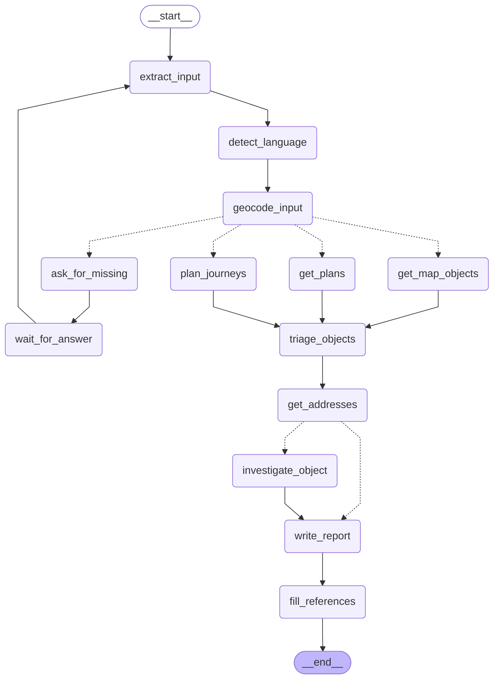
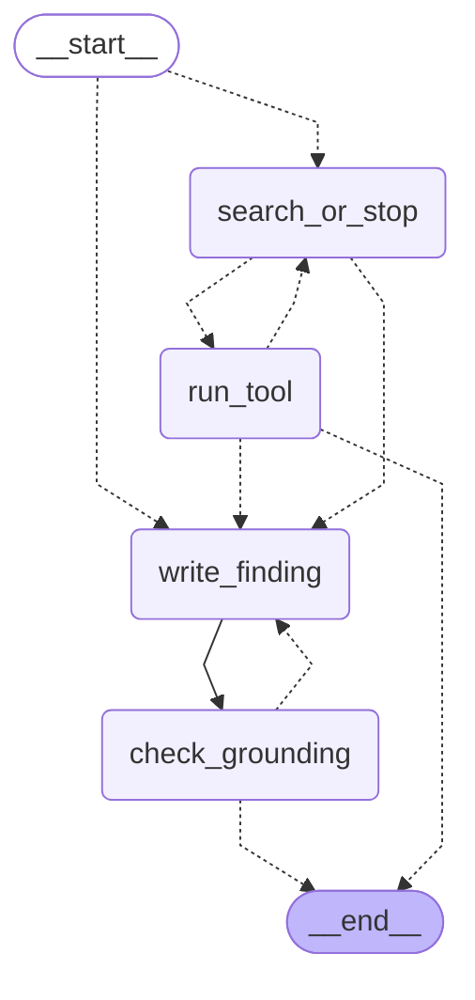

# The compiled graph

The two graphs as LangGraph compiles them from the code and draws them itself, so they cannot
drift from it: a test fails when the code and this page differ. They show the nodes and the
edges only. What each step does, its data source and who decides what are in the
[architecture](architecture.md). A solid edge is always taken; code picks a dashed one at run
time.

## One run

The graph of `agent.build_graph()`. Each object chosen for investigation goes to
`investigate_object`, in parallel with the others, and that node runs the investigation graph
below.

## The investigation

The graph of `investigation.build_graph()`, run once for each object chosen for
investigation. Before each call to the model, code checks the cap of tool calls on the edge
and goes to `write_finding` once it is reached; this is why both `__start__` and `run_tool`
have a dashed edge to it. A run starts with no calls, so with a cap of 1 or more it always
goes to `search_or_stop` first.

