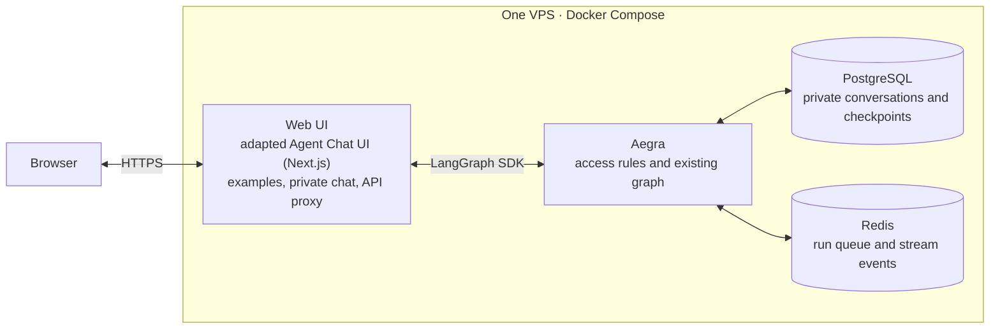

# Demo architecture

A browser demo of the existing agent: one private conversation per browser identity and
recorded examples, without sign-up. The [agent architecture](architecture.md) describes the
research; [ADR 4](adr/0004-demo-aegra-and-agent-chat-ui.md) records the stack choice.

This document defines the design. Implementation work and progress are tracked in
[demo steps 6 to 8](roadmap.md#after-the-mvp-the-demo).
The [launch checklist](demo-launch-checklist.md) defines the requirements for enabling live input.

## Services

Only the Web UI service is publicly reachable. It adapts Agent Chat UI and adds a server-side
API proxy in Next.js. Aegra, PostgreSQL and Redis use the private container network.
One Aegra container runs `aegra serve` with `REDIS_BROKER_ENABLED=true`, using its
[built-in worker recovery](https://github.com/aegra/aegra/blob/v0.10.8/docs/guides/worker-architecture.mdx#crash-recovery).
The demo uses one Aegra process, with its worker tasks in the same process, so admission
and cancellation share one coordinator. A PostgreSQL session lock rejects a second process
at startup. This guards against accidental duplicate starts, not database failover. Stop Aegra
before restarting PostgreSQL, and restart Aegra after unexpected database connection loss
before starting another instance. The deployment does not use replicas or rolling updates.
PostgreSQL persists server records and checkpoints; Aegra v0.10.8
[requires it](https://github.com/aegra/aegra/blob/v0.10.8/libs/aegra-api/src/aegra_api/core/database.py).
The setup lives in `demo/`.

Demo table creation is a deployment step in `demo/db/`, outside the runtime package and
image. Apply it before starting Aegra; the server does not create or change the demo schema.
Run Aegra's own migrations separately with `RUN_MIGRATIONS_ON_STARTUP=false` on the server.
Aegra 0.10.8 still performs its built-in LangGraph checkpoint/store setup at startup; it has
no setting to disable that part.

Redis runs on the same VPS without RDB snapshots or AOF persistence, and without a
persistent data volume. PostgreSQL holds the work needed for recovery after Redis restarts.
Aegra's replay buffer already expires
[10 minutes after the last event](https://github.com/aegra/aegra/blob/v0.10.8/libs/aegra-api/src/aegra_api/services/redis_broker.py);
the value is defined in [base_broker.py](https://github.com/aegra/aegra/blob/v0.10.8/libs/aegra-api/src/aegra_api/services/base_broker.py).
Explicit chat deletion also removes its Redis data immediately after workers stop.

The scripted dialogue runner and judge settings belong in `evals/`, with settings in
`evals/config.py` and examples in `evals/.env.example`.
Keep agent settings in `src/out_of_frame/config.py` and the root `.env.example`.
Demo server code and settings live in `demo/backend/`, outside the reusable agent package;
Next.js server settings use environment variables. All demo tests live in `tests/demo/`,
with infrastructure checks in `tests/demo/integration/`. The agent imports neither demo nor
eval code and reads neither demo nor judge settings. Tests and evals call the agent from outside.
The backend image contains only the agent, demo server and runtime dependencies. Exclude
tests, evals, fixtures, development tools, `.env` and `evals/results/`; pass secrets at runtime.

## Visitor and access

Next.js sets a random signed, HttpOnly, Secure, SameSite=Lax identity cookie on the
first admitted message. Refused admission sets no cookie. Its fixed lifetime is in
[Demo limits](#demo-limits); reading, replying or starting another chat never renews it.
The proxy verifies signature and expiry and replaces client-supplied identity headers.
Each cookie maps to a separate pseudonymous Aegra identity.

Only that identity can read its chat and report or answer its questions. Clearing the cookie
loses access, even with the chat URL; the server still deletes records at their original
deadline. Static examples and legal pages need no cookie. Visitor content is never published.

Keep one current conversation per identity, including across tabs. `New chat` deletes it
before creating another; `Delete chat` removes it without replacement. Label the destructive
effect. Both operations require ownership and CSRF checks and use the deletion procedure
below. Serialise replacement and admission per identity. If a chat quota is exhausted,
disable replacement while keeping the existing chat readable and deletable.
A completed conversation can be read or deleted, not continued.

The interface is in English for an English-reading adult technical audience. Before input,
show the [start notice and service terms](demo-launch-checklist.md#before-the-first-message).
Show remaining submissions and the message-length limit. On refusal, explain the relevant
limit and reset, if any; keep examples, saved reports and deletion available.
Offer a dedicated author contact for questions, feedback, data requests or an arranged demo.

Use these refusal messages without quota numbers:

- `identity_chats_exhausted`: "You have reached your usage limit. Contact the author for
  further access." Link to the author contact; do not suggest a daily reset for this limit.
- `daily_chats_exhausted`: "Today's limit for new chats has been reached. Please try again
  tomorrow." Show the next Berlin-midnight reset in the visitor's local time.

Both limits apply to new conversations. Existing admitted conversations can continue within
their submission limit. Keep examples, saved reports and deletion available.

## From a message to a report

One conversation is one Aegra thread. The initial message and each answer start separate
runs on that thread:

1. Next.js checks the cookie and region, constructs the permitted request, and Aegra checks
   ownership and reserves quota before execution.
2. The graph adds its question to `messages` and pauses with `interrupt()`. The next answer
   resumes the saved checkpoint with `Command(resume=...)`.
3. Existing research and report steps run. The page shows progress and fixed service-failure
   notices, as the CLI does.
4. After filling references, credits and translated text, the graph adds the finished report
   as an AI message with the stable ID `final-report`. Replaying that step must not duplicate
   the message. Completion requires the latest run to be `success`, its latest checkpoint to
   have no next node or pending interrupt, and that checkpoint to contain `final-report`.
   The page and admission use the same server-side check. An idle thread or a draft in
   `report` alone does not mean completion.

Use LangChain messages, keep `report` and loading of old saved runs, and let the caller supply
the checkpointer. CLI and evals keep their memory checkpointer. Build the Berlin date and web
search client on the server for each invocation; neither belongs in client input or saved
state. Research rules and prompts stay the same.

Every run uses `on_disconnect=continue` and checkpoint `durability=sync`. Leaving the page
does not cancel it; refresh reconnects. Aegra recovers crashed runs from their last checkpoint
with bounded retries, using the same admitted run and no extra submission quota. An interrupted
external call may repeat. After an execution error, an owner-requested retry resumes the latest
server-selected checkpoint within the limits. Fixed source-failure notices come from saved
`failures` alongside the report; they are not part of its Markdown and need no model call.

### Browser responses

The Next.js proxy filters data before it reaches the browser. Agent Chat UI normally
requests [state values and subgraphs](https://github.com/langchain-ai/agent-chat-ui/blob/main/src/components/thread/index.tsx).
The demo sets stream modes on the server: top-level `values` and `updates`, with subgraph
streaming off. Forward only visible user messages, questions, the final report, failure codes
and progress node names. Include only the status, interrupt and identifier fields needed to
resume and reconnect; filter message fields too.

Apply the same allowlist to streams, replay, thread/run reads and any exposed state/history
responses. Disable unused history routes and the UI's automatic history fetch. Drop source
texts, findings, subgraph data, draft reports, internal model/tool output and raw errors.
Hiding them in React is insufficient. Test that a planted source-text marker never reaches
the browser through any exposed route.

### Report rendering

Escape user addresses and destination names as plain text in `fill_references` and
`describe_journeys`, including Markdown link and HTML syntax. List labels are plain text.
Both live and recorded report views disable raw HTML and bare-URL autolinking while allowing
explicit source links. `OSM_CREDIT` and `TRANSITOUS_CREDIT` in `report.py` use explicit
Markdown links with the attribution words and targets required by
[data rights](sources.md#data-rights).
Test input such as `[Prize](https://example.com)` alongside working licence links.

## Static examples

The author prepares five recorded conversations as frontend files in `demo/`.
Each contains visible messages, the finished Markdown report and fixed service-failure
notices, with source links, credits and the AI notice. Use public places and fictional
journeys, without real people's personal details. Review each export; exclude raw graph
state, source-page bodies, credentials and visitor data.

Label them as recorded examples. They need no database, cookie, model call or quota and stay
available when live input is unavailable. They cannot be resumed. Visitor conversations never
become examples automatically.

## Retention and deletion

Delete the current conversation by the identity's original expiry. A second conversation
gets only the remaining time. `New chat`, `Delete chat`, a valid deletion request or closure
of the demo removes it earlier. Losing the cookie or closing a tab is not a deletion signal.
One conversation can have many checkpoints; remove all of them.

Use one repeatable deletion procedure for replacement, explicit deletion and expiry:

1. Under the identity's admission lock, record that deletion is pending and block new runs
   and recovery for that conversation. Expired or deleting content is immediately inaccessible.
2. Cancel pending/running work through Aegra and wait for worker tasks to settle. A terminal
   database status alone does not prove a delayed worker stopped. On timeout, leave deletion
   pending for retry; do not purge while a worker could still write.
3. Remove Redis jobs, replay buffers and counters for the thread's runs, then the Aegra thread,
   checkpoints, run records, source texts and report. Preserve the run IDs needed to retry a
   partial purge until it finishes. Complete deletion only when recovery cannot recreate data.

Use Aegra v0.10.8's [native TTL pruning](https://github.com/aegra/aegra/blob/v0.10.8/libs/aegra-api/src/aegra_api/services/thread_ttl.py)
with `strategy=delete` and each thread's TTL set to the remaining identity lifetime.
After workers stop and Redis is cleared, the coordinated procedure calls Aegra's pruning
for the expired identity. For early deletion, use Aegra's standard thread deletion instead.
Aegra performs the thread and checkpoint deletion; the demo does not reimplement it.

Disable only Aegra's independent background sweeper: it skips active runs and does not clean
Redis or demo accounting, so it cannot perform the whole procedure safely by itself.
A small demo task coordinates these extra steps and invokes native pruning at Aegra startup,
before accepting or recovering expired work, then periodically through an Aegra lifespan
task with a configurable interval. No separate cleanup command, operator API or admin UI
is needed. For a manual deletion request or demo closure, stop the backend and discard
all demo PostgreSQL and Redis data.

Chat deletion retains admission accounting: the aggregate count for the current Berlin day
and the identity counter until its fixed expiry. Keep only random ID, expiry, admitted-chat
count, current thread reference and any pending-deletion bookkeeping. Clear the reference
after deletion; remove expired identity records after cleanup. Messages and addresses do not
belong in quota records.

Use private, non-cacheable responses; exclude chat content from backups and persistent
frontend caches. Keep chat bodies and source text out of logs and disable external tracing.
Necessary security log metadata has a separate retention limit below. Test expiry, interrupted
deletion and restart recovery; record actual deletion timing in the launch checklist.
Provider retention is separate from deletion on our server.

## Demo limits

Configurable demo defaults belong in `demo/backend/config.py`; worker settings use Aegra's
environment variables. This table is the source for numeric demo limits; the page and
notices use the configured values.

| Setting | Default |
|---|---|
| New conversations across all visitors | 5 per calendar day in Europe/Berlin |
| New conversations per identity | 2 over its whole cookie lifetime |
| Cookie and current-chat lifetime | 30 days from the identity's first admitted message, without renewal |
| User submissions per conversation | 7 in total, including the first message, answers and manual retries |
| User message length | 2,000 characters |
| Active runs per conversation | 1 |
| Executing runs across all visitors | 1 (`WORKER_COUNT=1`, `N_JOBS_PER_WORKER=1`) |
| Necessary security log metadata | Up to 24 hours |

Use Aegra's existing Redis queue for other admitted runs. They stay `pending` until the
worker is free, then start automatically. Completion, an error or an input interrupt releases
the slot; waiting for a user's answer does not occupy it. Admission consumes quota once;
waiting, refresh and reconnect do not submit another run or consume another slot.

While a run is `pending`, show: "Service is busy. Your request is queued and will start
automatically." Switch to progress when it starts. Keep queued work visible after refresh
and allow chat deletion while waiting. Do not add a separate queue, automatic resubmission,
queue positions or time estimates. This bounds parallel workflows, not provider requests
or tokens per minute; verify Anthropic limits for a single workflow at launch.

Aegra's demo access handlers enforce limits independently of the page. Small demo tables in
PostgreSQL keep identity/chat counters and the aggregate daily count. Reserve both new-chat
quotas and the submission slot atomically before execution. Count a conversation at its first
admitted run, even a greeting; abandoned input therefore consumes quota. Errors, deletion,
refresh and reconnect do not refund quota. Midnight resets only the global daily counter.
Agent questions and automatic recovery do not consume submissions. The last allowed user
submission can still start research if input is complete. Read requests are free of quota.

Clearing cookies can bypass the per-identity fairness limit; the global limit still bounds
admissions. No fingerprinting is planned. Existing limits on model output, source length,
objects, Tavily tool calls and retries remain. Separate provider budgets are set at launch;
there is no custom daily money or token ledger.

The proxy exposes only needed routes, accepts text or a resume answer, and fixes the
assistant, `multitask_strategy=reject`, `on_disconnect=continue` and `durability=sync`.
For retries it selects the latest checkpoint. Reject client execution overrides, state edits,
branching, stateless runs and arbitrary thread creation; the page also disables regeneration.
Aegra handlers validate the contract, but
[cannot rewrite all run fields](https://github.com/aegra/aegra/blob/v0.10.8/libs/aegra-api/src/aegra_api/api/runs.py),
so request construction stays in Next.js.

Next.js checks live-run regional eligibility before forwarding requests to providers.
Use a trusted hosting signal or a local IP-country database; select the source, update process
and licence when choosing the host. Never trust a country header supplied by the browser.
Unsupported or unknown regions get recorded examples. Provider-policy checks belong in the
[launch checklist](demo-launch-checklist.md#providers-and-regions).

## Implementation checks

The integration check uses a stubbed model and sources: a question, server restart,
answer through the SDK, and a finished report. Further checks cover:

- disconnection and worker crash during research, recovery and duplicate final-message prevention;
- visitor isolation, spoofed identity/execution parameters, CSRF and filtered browser responses;
- concurrent admissions and tabs, exhausted input, overlong messages and quota persistence;
- a busy worker, queued runs starting after completion or input interruption, reconnect
  without resubmission and deletion while queued;
- replacement, expiry and deletion during a run, cancellation timeout, delayed writes and retries;
- report escaping, clickable credits and saved failure notices after reload;
- region checks and the examples-only fallback; package and image separation from eval code.

Check two separate browser sessions and a narrow screen. A live run needs approval of its
estimated cost.
